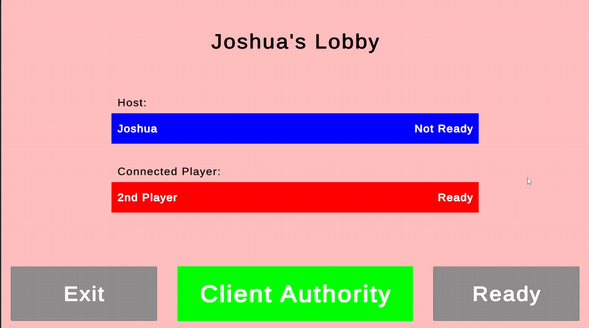
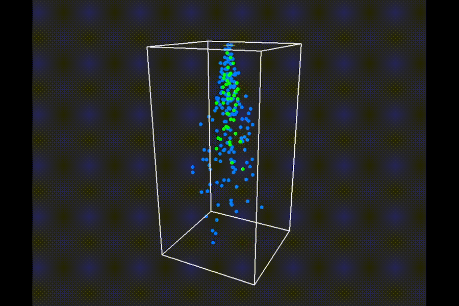
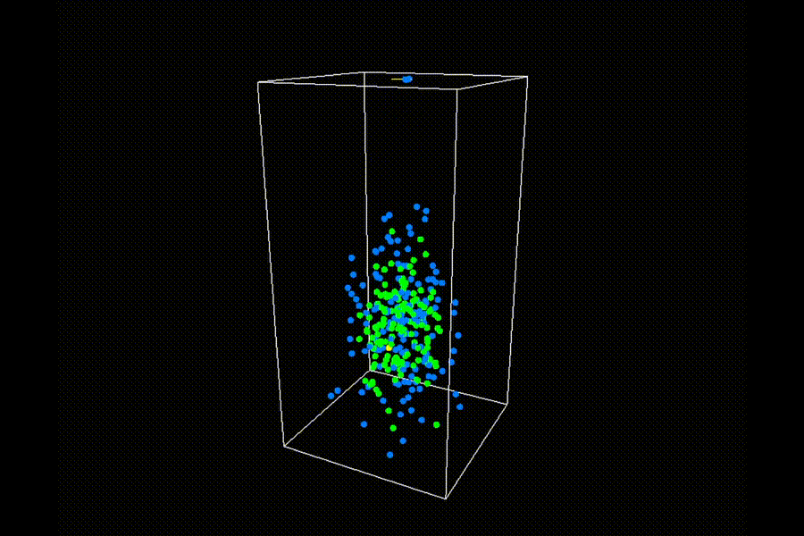
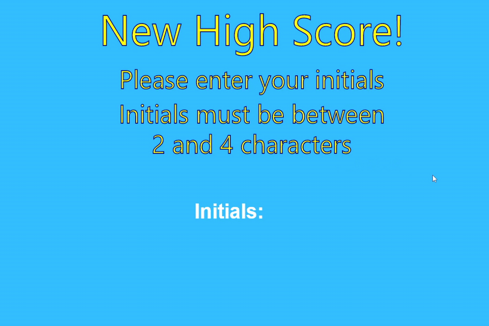

# Josh Adamson

## Graduate Games Programmer

### About Me

I am a fourth-year MEng Computer Science student at the University of Hull, currently in my final year and working towards a career as a games programmer.

My projects have given me experience across multiplayer networking, gameplay AI, game architecture, parallel programming, real-time graphics, virtual reality and mixed reality. I particularly enjoy technical gameplay and systems work, including problems involving performance, architecture and player responsiveness.

I am currently continuing to develop my C++ and lower-level programming experience through combined final-year work in C++ Programming and Design and Real-Time Graphics using Vulkan 1.3, alongside team-based commercial development practice.

**GitHub:** [JoshuaAdamson05](https://github.com/JoshuaAdamson05)  
**Email:** [joshada05@hotmail.com](mailto:joshada05@hotmail.com)

---

# Featured Projects

## Local Networked Table Football

**Unity · C# · Multiplayer Networking**

A 2D LAN multiplayer table-football game developed as my individual Honours project, focused on responsive gameplay networking and synchronisation.

### Highlights

- Custom **30 Hz tick-based networking system**
- Client prediction and server reconciliation
- Snapshot interpolation and bounded extrapolation
- UDP LAN host discovery
- Server- and client-authoritative movement modes
- Runtime networking and synchronisation metrics

---

## Parallel Particle Simulation — Rust CPU vs CUDA GPU

**Rust · C++ · CUDA · OpenGL · Parallel Programming**

| Rust CPU | CUDA GPU |
| --- | --- |
|  |  |

Two implementations of the same particle shower simulation, developed to compare CPU multithreading with massively parallel GPU processing.

Both versions simulate large particle populations with physics, temperature behaviour, spatially partitioned collision detection and particle merging.

### Highlights

- Multithreaded CPU simulation implemented in Rust
- GPU simulation implemented using C++ and CUDA
- Spatial-grid collision detection
- Parallel particle collision and merge processing
- Profiling and optimisation of individual simulation stages

### Performance

| Implementation | Hardware | 500,000-particle simulation |
| --- | --- | ---: |
| Rust CPU | Intel Core i5-13600KF | ~41.6 ms |
| CUDA GPU | NVIDIA RTX 4070 Ti | ~0.93 ms |

---

## 2v2 Football AI Simulation

**C# · MonoGame · Game AI**

<video autoplay loop muted playsinline preload="metadata" poster="assets/images/football-ai-poster.jpg" style="width:100%; height:auto;">
  <source src="assets/videos/football-ai.mp4" type="video/mp4">
</video>

An autonomous 2v2 football simulation focused on individual agent behaviour and team-level decision-making.

### Highlights

- Finite state machines for autonomous agents
- Team-level attacking and defending states
- Dynamic assignment of player roles
- Steering behaviours for autonomous movement
- Roles including dribbling, tackling, guarding and sweeper-keeping

---

## Games Architecture

**C# · OpenTK · OpenGL · Game Systems**

<table>
  <tr>
    <th>Drone Combat</th>
    <th>High-Score Submission &amp; Retrieval</th>
  </tr>
  <tr>
    <td>
      <video autoplay loop muted playsinline preload="metadata" poster="assets/images/games-architecture-poster.jpg" style="width:100%; height:auto;">
        <source src="assets/videos/games-architecture.mp4" type="video/mp4">
      </video>
    </td>
    <td></td>
  </tr>
</table>

A game architecture project centred around a small drone-combat game, focused on designing reusable engine systems for gameplay, rendering and game-world management.

### Highlights

- Designed and implemented an **Entity Component System**
- Implemented collision detection and response systems
- Developed navigation meshes with **A\* pathfinding** for autonomous agents
- Built a **scene-management system** with scene transitions and shared transition data
- Developed an asynchronous **TCP high-score client/server** with JSON persistence
- Built resource management for geometry, textures, shaders and audio
- Separated reusable engine-level systems from game-specific behaviour

---

## Real-Time Graphics — OpenGL

**C# · OpenTK · OpenGL · GLSL**

<video autoplay loop muted playsinline preload="metadata" poster="assets/images/opengl-stadium-poster.jpg" style="width:100%; height:auto;">
  <source src="assets/videos/opengl-stadium.mp4" type="video/mp4">
</video>

A real-time graphics project focused on lower-level rendering, transformation mathematics and scene organisation using OpenGL.

### Highlights

- Custom vector and matrix maths
- Translation, rotation and scaling transformations
- VAOs, VBOs and EBOs
- Indexed and non-indexed rendering
- Vertex and fragment shaders
- Procedural primitive geometry
- Hierarchical scene graphs and recursive rendering
- Visitor-pattern processing of scene-graph nodes

---

## Mixed Reality Bowling

**Unity · C# · Meta XR · MRUK · Mixed Reality**

<table>
  <tr>
    <th>Lane Placement</th>
    <th>Bowling &amp; Game Loop</th>
  </tr>
  <tr>
    <td>
      <video autoplay loop muted playsinline preload="metadata" poster="assets/images/mr-bowling-lane-placement-poster.jpg" style="width:100%; height:auto;">
        <source src="assets/videos/mr-bowling-lane-placement.mp4" type="video/mp4">
      </video>
    </td>
    <td>
      <video autoplay loop muted playsinline preload="metadata" poster="assets/images/mr-bowling-strike-reset-poster.jpg" style="width:100%; height:auto;">
        <source src="assets/videos/mr-bowling-strike-reset.mp4" type="video/mp4">
      </video>
    </td>
  </tr>
</table>

A mixed-reality bowling game developed in Unity, integrating virtual bowling gameplay with the player's scanned physical environment using Meta XR and MRUK.

### Highlights

- Used passthrough and MRUK scene data to integrate virtual content with the physical environment
- Dynamically placed the bowling lane against detected floor geometry using controller raycasts
- Implemented bowling-ball spawning, grabbing, releasing and physics-based interaction
- Built pin spawning, knock detection, clearing and reset behaviour
- Implemented ten-pin bowling scoring including strikes, spares and tenth-frame rules
- Built a live scoreboard and complete frame/game reset loop

---

## Virtual Sports Hall VR

**Unity · C# · Unity XR Interaction Toolkit**

A VR sports-hall project developed in Unity as assessed university work, implementing a range of XR interactions, physics-based sports mechanics and interactive environmental elements. Unity XR tutorial material was used as a foundation, which I adapted and integrated into the final application.

<table>
  <tr>
    <th>Sports Interaction</th>
    <th>Object / Socket Interaction</th>
    <th>Interactive Environment</th>
  </tr>
  <tr>
    <td>
      <video autoplay loop muted playsinline preload="metadata" poster="assets/images/vr-tennis-poster.jpg" style="width:100%; height:auto;">
        <source src="assets/videos/vr-tennis.mp4" type="video/mp4">
      </video>
    </td>
    <td>
      <video autoplay loop muted playsinline preload="metadata" poster="assets/images/vr-hat-poster.jpg" style="width:100%; height:auto;">
        <source src="assets/videos/vr-hat.mp4" type="video/mp4">
      </video>
    </td>
    <td>
      <video autoplay loop muted playsinline preload="metadata" poster="assets/images/vr-keypad-door-poster.jpg" style="width:100%; height:auto;">
        <source src="assets/videos/vr-keypad-door.mp4" type="video/mp4">
      </video>
    </td>
  </tr>
</table>

### Experience Demonstrated

- Implemented and configured grab, throw and physics-based sports interactions
- Worked with socket-based interactions for wearable and placed objects
- Integrated interactive environmental elements including a scanner, movable posters and a keypad-controlled door
- Tested and refined interaction behaviour in VR

---

# In Progress

## C++ & Real-Time Graphics — Vulkan 1.3

**C++ · Vulkan 1.3 · GLSL · Software Design**

Currently developing a Vulkan 1.3 real-time graphics application that combines work from my final-year C++ Programming and Design and Real-Time Graphics modules.

The project applies C++ programming and software-design principles directly to lower-level graphics development, including graphics-pipeline configuration, shader integration, buffer management, model transformations, push constants and multiple draw calls.

### Current Focus

- Applying modern C++ design principles within a graphics codebase
- Managing object lifetimes and resources in a low-level API
- Configuring Vulkan 1.3 graphics pipelines
- Working with vertex and fragment shaders
- Using uniform buffers and push constants
- Rendering multiple objects with independent transformations
- Exploring different primitive topologies and rendering techniques

---

## Commercial Development Practice

**Team Development · Customer Project · Scrum · PRINCE2**

Currently working as part of a development team on a final-year commercial development project based around a customer brief.

The project provides experience of working within a structured development team, managing requirements and responsibilities, communicating with a customer, and applying Scrum alongside PRINCE2 project governance.

As the project develops, I will add more detail about my individual technical contribution.

---

# Technical Skills

## Languages

`C++` `C#` `Rust` `Python`

## Game & Graphics Technologies

`Unity` `MonoGame` `Vulkan 1.3` `OpenGL` `OpenTK` `CUDA` `GLSL`

## XR & Mixed Reality

`Unity XR Interaction Toolkit` `Meta XR SDK` `Meta XR MRUK` `Passthrough` `Scene Understanding`

## Networking & Systems

`Netcode for GameObjects` `Unity Transport` `UDP` `Client Prediction` `Server Reconciliation` `Snapshot Interpolation`

## Tools

`Git` `GitHub` `Visual Studio` `Unity Profiler`

---

# Contact

**Email:** [joshada05@hotmail.com](mailto:joshada05@hotmail.com)  
**GitHub:** [JoshuaAdamson05](https://github.com/JoshuaAdamson05)
